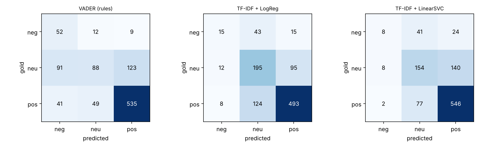
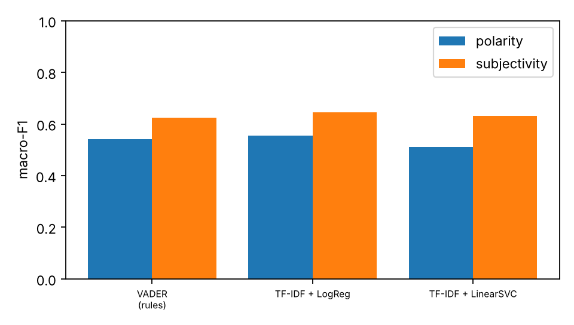

# Q4 Classification Evaluation: ShopSmart Advisor

## 1. Dataset
- **1,000 review chunks** from the Amazon Reviews 2023 Electronics knowledge base (`master_annotation_final.csv`, exported as `eval.xls`).
- **Two annotators** labeled independently. Disagreements were adjudicated into the final `label`.
- **Polarity labels:** 625 positive / 302 neutral / 73 negative.
- **Subjectivity labels:** 773 subjective / 227 objective.
- **Inter-annotator agreement:** raw 89.4% (894/1000), Cohen's kappa 0.798, which meets the 80% requirement. All 106 disagreements are cases where annotator 1 chose positive (78) or negative (28) and annotator 2 chose neutral.

## 2. Method
- **Task A, polarity:** positive / neutral / negative. **Task B, subjectivity:** subjective / objective.
- **Models:**
  - VADER, rule-based with no training. Positive if compound >= 0.05, negative if <= -0.05, otherwise neutral. For subjectivity, |compound| >= 0.05 means subjective.
  - TF-IDF (1-2 grams) + Logistic Regression, class-balanced.
  - TF-IDF + LinearSVC, class-balanced.
  - **RoBERTa zero-shot** (`cardiffnlp/twitter-roberta-base-sentiment-latest`), the sentiment model used by the Why-not panel. It is applied as is, with no training on the eval set, and was run for polarity only.
- **Protocol for the trained models:** 5-fold cross-validation grouped by product (ASIN), so reviews of one product never appear in both train and test. Predictions are pooled across folds.
- **Text preprocessing:** the `[Product: ... | ASIN: ...]` prefix, ` ` tags and HTML entities are removed before modelling.
- **Metrics:** accuracy, macro-F1 (the main metric, because classes are imbalanced), per-class precision/recall/F1, and a 95% bootstrap CI for macro-F1 (1,000 resamples). Latency is the average per-item milliseconds on the machine that ran the script, so it is not comparable across machines.

## 3. Results: polarity (n = 1,000)

| Model | Accuracy | Macro-F1 (95% CI) | F1 neg | F1 neu | F1 pos | ms/item |
|---|---|---|---|---|---|---|
| VADER (rules) | 0.675 | 0.541 (0.502-0.577) | 0.40 | 0.39 | 0.83 | 0.17 |
| TF-IDF + LogReg | 0.719 | 0.561 (0.514-0.604) | 0.27 | 0.60 | 0.82 | 1.52 |
| TF-IDF + LinearSVC | 0.723 | 0.523 (0.478-0.564) | 0.19 | 0.55 | 0.83 | 0.67 |
| RoBERTa zero-shot (cardiffnlp) | 0.673 | 0.566 (0.532-0.603) | 0.39 | 0.50 | 0.82 | 7.80 |

Majority-class baseline (always positive): accuracy 0.625, macro-F1 about 0.26.

Precision / recall per class:

| Model | negative | neutral | positive |
|---|---|---|---|
| VADER (rules) | 0.28 / 0.71 | 0.59 / 0.29 | 0.80 / 0.86 |
| TF-IDF + LogReg | 0.44 / 0.19 | 0.57 / 0.63 | 0.81 / 0.82 |
| TF-IDF + LinearSVC | 0.43 / 0.12 | 0.62 / 0.49 | 0.77 / 0.90 |
| RoBERTa zero-shot (cardiffnlp) | 0.26 / 0.71 | 0.58 / 0.43 | 0.85 / 0.78 |

Confusion matrices (rows = gold, columns = predicted: neg / neu / pos):

| gold | VADER (rules) | TF-IDF + LogReg | TF-IDF + LinearSVC | RoBERTa zero-shot (cardiffnlp) |
|---|---|---|---|---|
| neg | 52 / 12 / 9 | 14 / 40 / 19 | 9 / 37 / 27 | 52 / 15 / 6 |
| neu | 91 / 88 / 123 | 11 / 190 / 101 | 8 / 149 / 145 | 90 / 131 / 81 |
| pos | 41 / 49 / 535 | 7 / 103 / 515 | 4 / 56 / 565 | 55 / 80 / 490 |

## 4. Results: subjectivity (n = 1,000; RoBERTa not run)

| Model | Accuracy | Macro-F1 (95% CI) | F1 objective | F1 subjective |
|---|---|---|---|---|
| VADER (rules) | 0.770 | 0.623 (0.590-0.658) | 0.39 | 0.86 |
| TF-IDF + LogReg | 0.770 | 0.655 (0.621-0.687) | 0.45 | 0.85 |
| TF-IDF + LinearSVC | 0.770 | 0.634 (0.599-0.667) | 0.41 | 0.86 |

## 5. Analysis
- **RoBERTa has the highest polarity macro-F1 (0.566), but not by a significant margin.** The 95% intervals of all four models overlap (0.48-0.60), so the ranking should not be over-read. On accuracy the TF-IDF models lead (0.72) and RoBERTa is lowest (0.673).
- **Negative reviews are where RoBERTa and VADER differ from the TF-IDF models.** RoBERTa and VADER both recall 71% of negative reviews (52 of 73), against 12-19% for the TF-IDF models. Their negative precision is only 0.26-0.28, because 90 neutral reviews are predicted negative by RoBERTa and 91 by VADER.
- **Neutral is the hardest class.** RoBERTa improves neutral F1 over VADER (0.50 vs 0.39), but the trained TF-IDF models are best on it (0.55-0.60), since they learn this dataset's idea of neutral. Lukewarm reviews, such as "adequate" or "serviceable", are often predicted positive.
- **Positive is easy for every model** (F1 0.82-0.83).
- **Typical errors:** negative reviews written in a polite or narrative tone ("I used it for 2 years daily...") and short factual negatives ("Focusing is also slow") are predicted as neutral or positive.
- **Ceiling:** human agreement is 89.4% and the best model accuracy is 72%.
- **Cost:** VADER takes 0.17 ms per item. RoBERTa takes 7.8 ms per item on the machine that ran it, about 45 times more. The gain over VADER is +0.025 macro-F1, with the cost mostly buying better neutral and positive precision.
- **Subjectivity:** all models reach 0.77 accuracy, and macro-F1 is 0.62-0.65. Objective F1 is only 0.39-0.45, so separating factual from opinionated chunks is hard with these baselines.
- **Takeaway for the report:** a zero-shot transformer is not a clear win on this domain-specific labeling. A model fine-tuned on in-domain labels, or a threshold tuned for the neutral class, is the natural improvement.

## 6. Caveats
1. **Annotation provenance:** the first annotator's labels were drafted with an LLM and then checked, and the second annotator labeled independently. Describe the process that way in the report.
2. **Minority classes are small.** Negative has 73 examples, so its scores have wide uncertainty. Report macro-F1 and per-class F1, not accuracy alone.
3. **RoBERTa was not tuned on the eval set**, so its numbers are a fair zero-shot baseline. The TF-IDF numbers are cross-validated.
4. **Single run, fixed seed.** The cross-validation split uses seed 0. The CIs reflect sampling variation of the 1,000 rows, not variation across splits.
5. **Text cleaning:** 575 rows in the master file still carry the `[Product: ...]` prefix. It is removed before modelling here, but strip it from `eval.xls` too if the grader will read the text.

## 7. Files
- `eval_full.py`: reproduces everything above (`python eval_full.py master_annotation_final.csv out roberta`).
- `results.json`: all metrics, per-class numbers and confusion matrices.
- `confusion_polarity.png`, `macro_f1.png`: figures.
